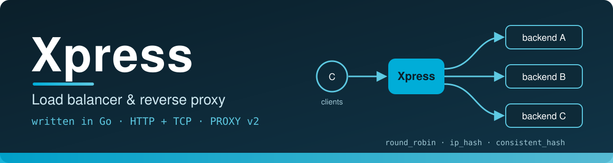

<p align="center">
  
</p>
<p align="center">
  
  
</p>
# Xpress

**Xpress** is a load balancer and reverse proxy written in Go. It sits in front of a set of backend servers, accepts client traffic, and forwards each request to a backend chosen by a configurable routing algorithm.

It is a systems/networking project built on the standard library (`net`, `net/http`, `net/http/httputil`) plus a small set of well-known packages for the CLI, configuration and logging.

> **Status:** early-stage. The HTTP reverse-proxy path works end to end. The TCP mode and some algorithms are still being built. See [Current status and known limitations](#current-status-and-known-limitations) before using this for anything beyond experiments.

---

## Table of contents

- [Features](#features)
- [Architecture](#architecture)
- [Project layout](#project-layout)
- [Getting started](#getting-started)
- [Configuration](#configuration)
- [Routing algorithms](#routing-algorithms)
- [Proxy modes](#proxy-modes)
- [Logging](#logging)
- [Rate limiting](#rate-limiting)
- [Trying it locally](#trying-it-locally)
- [Current status and known limitations](#current-status-and-known-limitations)
- [Roadmap](#roadmap)
- [Tech stack](#tech-stack)
- [Contributing](#contributing)
- [License](#license)

---

## Features

- **HTTP reverse proxy** built on `httputil.ReverseProxy`, with `X-Forwarded-*` headers set on outgoing requests.
- **Round robin** routing using an atomic counter, so backend selection takes no lock.
- **IP hash** routing for session affinity.
- **Consistent hashing** with 150 virtual nodes per backend and FNV-1a hashing.
- **TCP (L4) building blocks**: a connection pool, bidirectional copying with pooled 32 KB buffers, and PROXY protocol v2 headers so backends can see the real client address.
- **Per-IP sliding-window rate limiter** (1000 requests per minute per client IP).
- **Built-in `/healthz` endpoint** that returns `200 OK`.
- **Graceful HTTP shutdown** when the handler context is cancelled (5 second timeout).
- **Structured logging** with zerolog, a pretty console writer, and a rotating log file.
- **CLI** (`xpress start`) built with Cobra, and **YAML configuration** loaded with Viper.

---

## Architecture

```
                 ┌────────────────────────┐
   Clients ────► │ Xpress (0.0.0.0:<port>)│
                 └───────────┬────────────┘
                             │
              ┌──────────────┴──────────────┐
              │                             │
        mode: http                      mode: tcp
   (httputil.ReverseProxy)       (listener + connection pool)
              │                             │
              └──────────────┬──────────────┘
                             ▼
                   Routing algorithm
        (round_robin | ip_hash | consistent_hash)
                             │
                ┌────────────┼────────────┐
                ▼            ▼            ▼
            Backend A    Backend B    Backend C
```

For each HTTP request, Xpress:

1. Extracts the client IP from `RemoteAddr`.
2. Checks it against the sliding-window rate limiter.
3. Stores the IP on the request context under `client_ip`.
4. Selects a backend with the configured algorithm.
5. Proxies the request and logs the response status, method, path and chosen backend.

---

## Project layout

```
lb_router/
├── main.go                  # Cobra CLI, config loading, logger setup
├── config.yaml              # Sample configuration
├── go.mod / go.sum          # Root module (lb_router)
├── go.work / go.work.sum    # Go workspace: root module + ./router
└── router/
    ├── go.mod               # Module "router"
    ├── handler.go           # Algorithms, consistent hash ring, HTTP and TCP servers
    ├── config.go            # Config structs and algorithm/mode parsers
    ├── connection_pool.go   # TCP connection pool, PROXY v2, bidirectional copy
    ├── limiter.go           # Sliding-window rate limiter
    ├── log_rotation.go      # lumberjack rotation + current.log symlink
    └── interface.go         # Connection interface (placeholder)
```

The repository is a **Go workspace** with two modules: the root module `lb_router` (the CLI) and the `router` module (the library). The root module imports `router` directly, so the workspace file is required to build. See [Getting started](#getting-started).

---

## Getting started

### Requirements

- Go 1.27.1 or newer (as declared in `go.mod`)

### Build and run

From the repository root:

```bash
# run directly
go run . start --config ./config.yaml --port 8080

# or build a binary
go build -o xpress .
./xpress start -c config.yaml -p 8080
```

> **Note on `go.work`:** the root module imports `router` as a sibling module, which only resolves through `go.work`. The repository's `.gitignore` currently lists `go.work` and `go.work.sum`, so make sure these files are committed (remove them from `.gitignore`) or a fresh clone will fail to build. Alternatively, add a `replace router => ./router` directive and a matching `require` to the root `go.mod`.

### CLI reference

```text
xpress start [flags]

Flags:
  -c, --config string   Path to configuration file (default: ./config.yaml)
  -p, --port string     Listener port for the load balancer (default "8080")
```

Xpress always binds to `0.0.0.0` on the port given by `--port`.

If `--config` is omitted, Xpress looks for `config.yaml` in the current directory and then in `/etc/xpress/`.

---

## Configuration

Configuration is read from a YAML file. The sample `config.yaml`:

```yaml
server:
  listener: "127.0.0.1"
  server_name: ""
  port: "8080"
  certFile: ""
  certKey: ""

router:
  mode: "http"               # http | tcp
  algorithm: "round_robin"   # round_robin | ip_hash | consistent_hash
  urls:
    - "https://jsonplaceholder.typicode.com/"

logs:
  path: /var/logs/xpress/
  level: info
```

### Options currently used by the code

| Key | Description |
| --- | --- |
| `router.mode` | `http` (default) or `tcp`. Any other value falls back to `http`. |
| `router.algorithm` | `round_robin`, `ip_hash` or `consistent_hash`. Unknown values fall back to `round_robin`. |
| `router.urls` | List of backend URLs. In HTTP mode these must be full URLs including the scheme (for example `http://127.0.0.1:8000`). |

### Options that are parsed but not yet applied

The following keys exist in the config structs but are not yet wired into the running server:

| Key | Current behaviour |
| --- | --- |
| `server.port`, `server.listener` | Ignored. The listen address is `0.0.0.0` and the port comes from the `--port` flag. |
| `server.certFile`, `server.certKey`, `server.server_name` | Ignored. TLS is implemented in the server but the CLI passes empty certificate paths. |
| `logs.path`, `logs.level` | Ignored. Logs go to `./logs/` at debug level. |

### Environment variables

Viper is configured with the prefix `XPRESS` and automatic env lookup. The code comments give `XPRESS_ROUTER_MODE=tcp` as an example, but nested keys generally need an env key replacer (mapping `.` to `_`) to resolve, and none is configured yet. Treat environment overrides as untested until that is added.

---

## Routing algorithms

| `router.algorithm` | Behaviour |
| --- | --- |
| `round_robin` | An atomic counter cycles through the backend list in order. |
| `ip_hash` | FNV-1a hash of the client IP, modulo the number of backends. The same client always reaches the same backend while the backend list is unchanged. |
| `consistent_hash` | Each backend is placed on a hash ring with 150 virtual nodes. The client IP is hashed and mapped to the next node clockwise (with wrap-around), so adding or removing a backend only remaps a fraction of clients. |

If the client IP is missing from the request context, `ip_hash` and `consistent_hash` fall back to round robin.

`LeastConnection` and `LeastResponseTime` are declared as types in the code, but they cannot be selected from configuration yet. See the limitations below.

---

## Proxy modes

### HTTP (`mode: http`)

- Serves all paths through a reverse proxy to the selected backend.
- Sets `X-Forwarded-For`, `X-Forwarded-Host` and `X-Forwarded-Proto` on the outgoing request.
- Sets `User-Agent: Xpress-LoadBalancer/1.0` if the client sent none.
- Server timeouts: 10 s read-header, 15 s read, 30 s write, 5 min idle.
- `GET /healthz` returns `200 OK` from the load balancer itself (it does not check backends).

### TCP (`mode: tcp`)

- Accepts TCP clients and handles each in its own goroutine with a 10 second context timeout.
- Uses a bounded pool of backend connections (capacity 10), with a 3 second dial timeout.
- Sends a **PROXY protocol v2** header to the backend so it can recover the real client address.
- Copies data in both directions with 32 KB buffers drawn from a `sync.Pool`, with half-close handling.

TCP mode is a work in progress; see below.

---

## Logging

- Console output uses zerolog's pretty writer; file output is JSON.
- The active log file is `./logs/xpress.log`, with a `./logs/current.log` symlink pointing at it.
- Rotation (lumberjack): rotate at 10 MB, keep 5 backups, keep for 30 days, compress rotated files.
- Each proxied HTTP response is logged with status, method, protocol, path and chosen backend. Responses with status 400 or above are logged at error level.

Example entry:

```json
{"level":"info","Status":200,"Method":"GET","Protocol":"HTTP/1.1","RemoteAddr":"https://jsonplaceholder.typicode.com/","URL":"/posts","message":"[Xpress]"}
```

Note that the `RemoteAddr` field in the log holds the **selected backend URL**, not the client address.

---

## Rate limiting

A sliding-window limiter keeps a list of request timestamps per client IP and rejects requests once an IP exceeds **1000 requests per minute**. The limit is currently hard-coded in `NewRouterHandler`. A reusable `RateLimiterMiddleware` is also defined in `router/limiter.go` but is not used by the server.

---

## Trying it locally

Start three simple backends (any HTTP servers will do). For example, with Python:

```bash
mkdir -p /tmp/a /tmp/b /tmp/c
echo "backend A" > /tmp/a/index.html
echo "backend B" > /tmp/b/index.html
echo "backend C" > /tmp/c/index.html

python3 -m http.server 8000 --directory /tmp/a &
python3 -m http.server 8001 --directory /tmp/b &
python3 -m http.server 8002 --directory /tmp/c &
```

Point `config.yaml` at them:

```yaml
router:
  mode: "http"
  algorithm: "round_robin"
  urls:
    - "http://127.0.0.1:8000"
    - "http://127.0.0.1:8001"
    - "http://127.0.0.1:8002"
```

Run Xpress and send some requests:

```bash
go run . start -c config.yaml -p 8080

for i in 1 2 3 4 5 6; do curl -s http://localhost:8080/; done
```

With `round_robin` you should see the responses cycle A, B, C, A, B, C. Switch `algorithm` to `ip_hash` or `consistent_hash` and the same client will keep reaching one backend.

---

## Current status and known limitations

Xpress is under active development. These are the known gaps in the current code:

**Routing**
- `least_connection` and `least_response_time` cannot be selected: the config parser has no mapping for them, `LeastResponseTime` has no selector, and the connection counters used by least-connection are never populated.
- Round robin and IP hash will panic if `router.urls` is empty. There is no startup validation of the backend list.

**HTTP mode**
- The rate limiter sends a `429` response but does not `return`, so a rate-limited request is still proxied to a backend.
- There is no handling for the `url.Parse` error before the backend URL is used, and no health checks, retries, failover or circuit breaking.
- The proxy does not pass an explicit `Host` rewrite policy: with `SetURL`, the outgoing `Host` header becomes the backend's host, not the client's original one.
- HTTPS termination is implemented in `StartHTTPServer` but cannot be enabled from the CLI yet.

**TCP mode**
- The connection pool is created with the load balancer's own listen address as its target, not with a backend chosen by the routing algorithm, so TCP mode does not yet balance across `router.urls`.
- Backend connections are returned to the pool after use even though the connection has been half-closed, which makes pooled reuse unsafe in its current form.

**Configuration and operations**
- `server.*` and `logs.*` options are not applied (see [Configuration](#configuration)).
- Errors returned by `StartServer` are not checked in `main.go`.
- No tests, metrics endpoint, or CI are in the repository yet.
- `router/interface.go` is a placeholder.

---

## Roadmap

- [ ] Wire up least-connection and least-response-time algorithms
- [ ] Backend health checks with automatic removal and recovery
- [ ] Select the TCP backend through the routing algorithm
- [ ] Enable HTTPS from `server.certFile` / `server.certKey`
- [ ] Apply `server.*` and `logs.*` settings and validate configuration at startup
- [ ] Fix the rate limiter so rejected requests are not proxied; make limits configurable
- [ ] Retries and failover to the next backend
- [ ] Metrics (for example Prometheus) and graceful signal handling
- [ ] Unit and integration tests, plus CI

---

## Tech stack

| Purpose | Library |
| --- | --- |
| Language | Go 1.27 |
| CLI | [spf13/cobra](https://github.com/spf13/cobra) |
| Configuration | [spf13/viper](https://github.com/spf13/viper) |
| Logging | [rs/zerolog](https://github.com/rs/zerolog) |
| Log rotation | [natefinch/lumberjack](https://github.com/natefinch/lumberjack) |
| PROXY protocol | [pires/go-proxyproto](https://github.com/pires/go-proxyproto) |

Concurrency primitives used: goroutines, `sync.WaitGroup`, `sync.Mutex` / `RWMutex`, `sync/atomic`, `sync.Pool` and buffered channels.

---

## Contributing

Issues and pull requests are welcome. For larger changes, please open an issue first to discuss the approach. Run `go vet ./...` and `gofmt` before submitting.

---

## License

No license is currently specified. Add a `LICENSE` file (MIT and Apache-2.0 are common choices) to make the terms of use clear.
